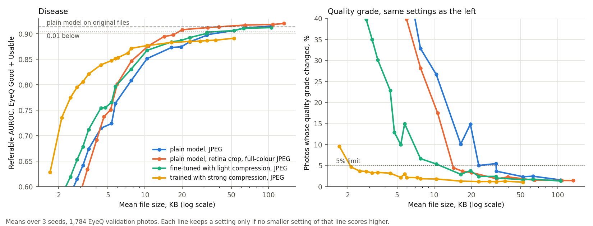

# retake-or-refer

Takes a colour retinal photo and tells a screening worker what to do next: refer the patient, retake the photo, or clear them. The goal is to catch a bad photo while the patient is still in the room, on a phone, with photos small enough to send over a weak network.

Right now you can run the data pipeline, a classical baseline, and small CNNs, including one joint model that handles quality, disease and fault reason, plus simple photo fixes for display and a measured answer to how small a photo can be sent. A 1.7 MB ONNX model runs in a phone browser page, though it hasn't been timed on a real phone yet, and `run.py` screens a folder of photos or a live camera. The final test has been run once, and the results are in the Phase 9 section, including the targets it missed. The [model card](docs/model_card.md) lists the limits. It has never been tried on a handheld camera. This is a research project and not a medical device.

## Setup

```bash
git clone https://github.com/K28Ayra/retake-or-refer.git
cd retake-or-refer
conda env create -p envs/retina -f environment.yml
conda activate ./envs/retina
pytest
```

The tests don't need data or a GPU.

## Getting the data

You need a Kaggle account for EyePACS. Accept the rules on the [competition page](https://www.kaggle.com/competitions/diabetic-retinopathy-detection/rules) first, because the download fails without that. Then create an API token and save it in `.kaggle/access_token` in the repo folder.

```bash
python scripts/00_download.py eyeq_labels
python scripts/00_download.py deepdrid
python scripts/00_download.py eyepacs_train
python scripts/00_download.py imagenette
python scripts/01_make_splits.py
python scripts/02_prepare_eyepacs.py train
python scripts/03_audit.py
```

`eyepacs_train` won't start with less than 60 GB free, though it peaks at about 45 GB. The zip gets deleted once the images are out, and you end up with about 6 GB in `data/`. Leave `eyepacs_test` alone until the final evaluation. It's another 53 GB and nothing before then should touch it.

To check your GPU can handle training:

```bash
python scripts/04_smoke_train.py --size 384 --batch 32
```

## Datasets

| Dataset | Used for | Images | Quality label |
|---|---|---|---|
| [EyeQ](https://github.com/HzFu/EyeQ) (on EyePACS photos) | train, val, test | 12,543 train, 4,000 of 16,249 test | good / usable / reject |
| [DeepDRiD](https://github.com/deepdrdoc/DeepDRiD) regular | train, val, test | 1,200 / 400 / 400 | binary |
| DeepDRiD ultra-widefield | outside camera check | 256 | none |
| Imagenette | testing the not-a-fundus check | 1,000 sampled | none |

Referable means ICDR grade 2 or higher. Splits are by patient.

There's no handheld camera data in this project. mBRSET is the one public handheld set with DR grades I could find, and it needs credentialed PhysioNet access, so I left it out. Results here won't tell you how the model does on handheld photos, and you should keep that in mind when reading any number in this repo.

Licences: DeepDRiD is CC-BY-SA-4.0, the EyeQ code is CC BY-NC-SA 4.0, and EyePACS comes with Kaggle's competition rules. No images are in this repo, so get them from the source and follow their terms.

## Layout

`retake/` is the small package with the reusable code. `scripts/` runs in number order. `phone/` is the browser page that runs the exported model. `configs/default.yaml` holds settings, including the `realtime` switch: `false` reads photos from a folder, `true` reads from a camera. `run.py` is the app.

## Phase 0: data

Built the splits and checked them before doing anything else. No patient appears in two splits, every image opens, and there are no exact duplicates.

Two things in the data changed the plan. DeepDRiD quality is binary, so the 0.65 to 0.70 from its challenge can't be compared with a three-class score. I'll compare against the EyeQ paper (0.8914 accuracy for ResNet18) instead. And no dataset labels why a photo is bad, so the blur / uneven light / low contrast output has to be trained on damage I add to photos myself.

A small training run on the EyeQ cache used 2.64 GB of GPU memory at 384 px, batch 32, at 283 images per second. More in [docs/phase0.md](docs/phase0.md).

## Phase 1: classical baseline

Hand-made features (sharpness, light evenness, contrast, colour, lesion-like spots) with gradient boosting.

```bash
python scripts/10_extract_features.py
python scripts/11_classical_quality.py
python scripts/12_check_leakage.py
python scripts/13_reason_rules.py
python scripts/14_not_fundus_and_timing.py
```

The whole thing takes a few minutes on CPU. Validation results:

| Task | Result |
|---|---|
| EyeQ quality, three classes | 0.924 accuracy, 0.867 macro-F1 |
| Same, reweighted to the EyeQ test class mix | about 0.882 accuracy, 0.851 macro-F1 |
| DeepDRiD quality, binary | 0.755 accuracy |
| Fault reason on added faults | 0.738 macro-F1 with thresholds, 0.844 with a small tree |
| Not-a-fundus | rejects 99.6% of ordinary photos, loses 0.2% of real ones |
| Referable AUROC on EyeQ Good + Usable | 0.696 |
| Feature time | 22.5 ms at 512 px on one thread |

Don't read that 0.924 as beating the published deep models. EyeQ validation has half the share of Usable photos that test has, and quality follows the camera: 17% of photos are Good at one photo size and 96% at another.

DeepDRiD has it worse. 74% of the 1976x1984 photos are referable and 29% of the 1736x1824 ones, so a model can score well by spotting the camera. From here on I report DeepDRiD disease scores per photo size. Details and what I tried are in [docs/phase1.md](docs/phase1.md).

## Phase 2: single-task CNNs

One network for quality, one for disease, and a look at how small they can get.

```bash
python scripts/20_make_deepdrid_cache.py
python scripts/22_run_phase2.py everything
python scripts/22_run_phase2.py final
python scripts/23_compare_phase2.py
python scripts/25_cpu_time.py
```

That's 42 trainings and about 5 hours on one GPU. A run is 5 to 12 minutes, and finished runs get skipped if you restart. To train just one, use `scripts/21_train_single.py`.

MobileNetV3 small at 384 px won, because nothing bigger did better. It's 6.1 MB and 12.9 ms per photo on one server CPU thread, which only tells you how the models rank. These are validation means over three seeds:

| Task | Classical | CNN |
|---|---|---|
| EyeQ quality accuracy | 0.924 | 0.945 |
| EyeQ quality macro-F1 | 0.867 | 0.905 |
| Usable recall | 0.735 | 0.882 |
| Referable AUROC on EyeQ Good + Usable | 0.696 | 0.917 |
| DeepDRiD disease AUROC | 0.81 | 0.969 |

The stretch goal of 0.92 AUROC is missed on the mean, though one seed got 0.922. Going up to 448 px added 0.001. These numbers come from the retrain after an augmentation bug I found in Phase 3. The script `scripts/31_run_phase3.py variants` reruns them. The rest of the doc still has the pre-fix comparisons.

My early stopping broke the first batch. It stopped runs while the learning rate was still high and scores were jumping around, so 18 of 30 quit too soon and the size comparison was meaningless. Small at 384 px went from 0.868 to 0.901 once every run got all 20 epochs. Putting EyeQ's Reject photos into disease training also helped, even though I'd left them out on purpose.

Don't take the DeepDRiD score at face value. A model that never saw DeepDRiD still got 0.939, because that set has far more severe disease than EyeQ (22% of photos against 2.6%) and is easier for reasons I can't fully explain. Quality scores are also flattered by picking the best epoch on validation. The rest is in [docs/phase2.md](docs/phase2.md).

## Phase 3: joint model

One MobileNetV3 small at 384 px with outputs for quality, disease, fault reason and the five DR grades.

```bash
python scripts/31_run_phase3.py variants
python scripts/31_run_phase3.py lighter_reason
python scripts/31_run_phase3.py more_seeds
python scripts/32_compare_phase3.py
```

That's 20 runs and about 5.5 hours on one GPU. Results on validation, as means over three seeds:

| Task | Two separate models | Joint |
|---|---|---|
| EyeQ quality macro-F1 | 0.905 | 0.909 |
| Referable AUROC on EyeQ Good + Usable | 0.917 | 0.913 |
| Size | 12.2 MB | 6.1 MB |
| Time on one server CPU thread | 26.9 ms | 13.0 ms |
| Fault reason macro-F1, on faults I added | none | 0.980 |

So half the size and time, with no sign of a loss. The confidence intervals are too wide to rule out a small one. Blur score against DeepDRiD's Clarity rating gets a Spearman of about -0.49.

Building this turned up a bug from Phase 2. With persistent data loader workers, each photo only ever saw 8 augmented versions over 20 epochs. Fixing that took AUROC from 0.907 to 0.917, so I retrained the separate models too, or the comparison would have flattered the joint one.

I also dropped the DeepDRiD quality output. It scored only 0.80 AUROC, lower than the classical model, and pulled both main scores down past my margin.

The 0.98 on reasons is on my own simulated damage and doesn't say much about real photos. On real EyeQ Reject photos the model names no fault about half the time, and that's the biggest open problem so far. No dataset labels why a real photo is bad, so I can't score it. More in [docs/phase3.md](docs/phase3.md).

## Phase 4: enhancement

The reason output picks one fix: unsharp mask for blur, tilt correction for uneven light, contrast stretch for low contrast, nothing if there's no fault. I compared that with always applying CLAHE, flat-field, Graham subtraction, or a tiny U-Net.

```bash
python scripts/40_tune_enhance.py
python scripts/43_train_unet.py --deep
python scripts/41_eval_enhance.py
python scripts/42_eval_enhance_model.py
python scripts/44_make_figures.py
```

About 20 minutes in all, once Phase 3 is done. These are validation numbers:

| Fix | SSIM on added faults | SSIM on Good photos | Model AUROC on real photos | Quality macro-F1 on real photos |
|---|---|---|---|---|
| Nothing | 0.899 | 1.000 | 0.914 | 0.909 |
| Always CLAHE | 0.915 | 0.945 | 0.869 | 0.857 |
| Graham subtraction | 0.761 | 0.606 | 0.645 | 0.598 |
| Tiny U-Net | 0.913 | 0.995 | 0.911 | 0.887 |
| Routed | 0.947 | 0.9998 | 0.911 | 0.879 |

Routed wins on the damage I added, at 9 to 23 ms per photo, and leaves good photos alone. But I wrote the fixes for those same faults, and no fix helped the model on real photos. So the model always reads the original, and the fixed photo is only for a person to look at.

Don't grade quality on a fixed photo. Brightening a bad one fools the grader, and macro-F1 drops from 0.909 to 0.879. Blur can't really be fixed either, since SSIM only goes from 0.869 to 0.879.

Some real dark photos came out with dark blobs or false colours that a reader could mistake for disease. Any enhanced photo needs to sit beside the original. They also show a fault I never simulated, which is that some photos are simply too dark. More in [docs/phase4.md](docs/phase4.md).

## Phase 5: compression

How small can a photo get before the model's answers change? I sent the 1,784 validation photos through JPEG and WebP at 9 quality levels and 5 sizes, with and without a crop to the retina first, starting from the original files.

```bash
python scripts/51_sweep.py plain_s0=outputs/phase3/joint_384_s0_nodeepdridquality_grade
python scripts/51_sweep.py --encoders jpeg444,jpeg444_retina plain_s0=outputs/phase3/joint_384_s0_nodeepdridquality_grade
python scripts/50_train_robust.py tune_light
python scripts/52_compression_curve.py
python scripts/53_curve_figure.py
```

`51_sweep.py` takes any number of `name=folder` pairs and scores them in one pass, because compressing the photos is the slow part. All four default encoders take about 3 hours.

Crop to the retina and save a 384 px JPEG at quality 95, keeping colour at full resolution (4:4:4). That's 40 KB against about 1 MB for the original. The threshold stays where it was set on original files, and sensitivity and specificity each move by under 1 point on the mean over three seeds. Normal JPEG halves the colour resolution, and that's where small red lesions are. Plain JPEG without the crop never gets there without losing more than 2 points of specificity. Squeeze harder and the model reads block artefacts as disease, so specificity collapses first.

Training with random compression didn't beat that. From scratch it cost at least 0.013 AUROC on clean photos. Fine-tuning the finished model with a frozen copy as teacher kept clean AUROC within 0.006, but still needed bigger files than the plain model with the better encoder. So I kept the plain model.



This measures the model, not a person looking at the photo, and I picked the setting on validation. More in [docs/phase5.md](docs/phase5.md).

## Phase 6: on the phone

```bash
python scripts/60_export.py --weights-only --tag _weights
python scripts/61_bench.py outputs/phase6/s1/fp32.onnx outputs/phase6/s1/int8_weights.onnx
python scripts/62_check_phone.py outputs/phase6/s1/int8_weights.onnx
```

The export makes one ONNX file per seed that takes 384 x 384 RGB bytes and does the normalising inside. Weights are int8, activations stay float, and it's 1.66 MB against 6.14. Over three seeds AUROC drops 0.003 and macro-F1 0.004. On one CPU core it takes 67 ms from a 10 MP JPEG to the answer, and only 7 ms of that is the model.

Full int8 with ONNX Runtime wrecked the model (AUROC 0.909 to 0.555). Batch norm folded into the first layers leaves channels whose ranges differ by hundreds of times, so one activation scale can't cover them. Quantising the first convolution alone was enough to break it. I tried leaving parts in float, percentile ranges and float biases, and none came close. So I store only the weights as int8.

The crop and resizing run in plain JavaScript in `phone/preprocess.js`. They match OpenCV pixel for pixel on 50 real photos, so the model gets the same input as in Python. Getting there meant copying two OpenCV rounding rules and its 32-bit sums.

To try it on a phone on the same Wi-Fi:

```bash
python scripts/63_serve_phone.py outputs/phase6/s1/int8_weights.onnx
```

Open the address it prints, then take or pick a photo. The page shows the decision with the same calibration and thresholds as `run.py`. It loads onnxruntime-web from jsDelivr, so the phone needs internet. If the phone can't reach the page, Windows Firewall or a Wi-Fi network that keeps devices apart is the usual cause. In Chrome on a Core i5 laptop the model took 27 to 30 ms. More in [docs/phase6.md](docs/phase6.md).

## Phase 7: refer, retake or clear

```bash
python scripts/70_predict_tuning.py outputs/phase6/s1/int8_weights.onnx
python scripts/71_tune_decision.py
```

The second one takes about 15 minutes and writes the thresholds to `configs/decision.yaml`.

The rule is "a bad photo can refer, but it can never clear". If the model calls a photo Reject but its disease probability is 0.48 or more, it refers now instead of asking for a retake. Usable photos get a middle band that asks for a retake, and Good ones get a single threshold. The thresholds minimise expected cost, with a miss costing 10, an unnecessary referral 1 and a retake 0.2. Those costs are my guess, not a clinician's.

Tuned and scored on the same photos, it's 9.3% cheaper than the usual gate that retakes every bad photo. On patients it wasn't tuned on it's 6.4% cheaper (CI 3.5 to 9.5%), which misses my 10% target. A four-threshold version overfit, so I kept three. It refers 62% of the referable photos the usual gate would send back for a retake, and 81% of those early referrals are right. A Reject photo never clears, and a unit test checks that.

The disease output needed Platt scaling, not just a temperature. Training with a weight on positives shifts every score, so 0.79 meant disease half the time. ECE went from 0.079 with a temperature to 0.005 with Platt.

With these costs the rule refers about a third of people, because anything above a 6% chance of disease is worth referring when a miss costs ten times more. More in [docs/phase7.md](docs/phase7.md).

## Phase 8: the app

```bash
python run.py --input photos/ --out outputs/run
python run.py --realtime on --source 0
python scripts/80_check_app.py
```

The first writes `results.csv` with quality, fault, chance of referable DR, decision and confidence, plus an enhanced picture for each photo. The second opens a camera, checks every frame for retina, light and sharpness, keeps the sharpest of the last 60 frames, and runs the model when you press space. `--source` also takes a phone camera stream address or a video file. `--realtime on|off` overrides the config, and with it off the camera code is never even imported. A test checks that.

The app doesn't need torch. On a laptop, `pip install -r requirements-live.txt` and the model file from Phase 6 are enough. Pass it with `--model`.

On 200 photos the app made exactly the same decisions as Phase 7. I had no fundus videos, so I made 50 clips from DeepDRiD photos that drift in and out of focus. It picked a sharp frame in 46 of them, after I moved the sharpness check from 320 to 640 px wide (40 of 50 before). On one server core it checks 88 frames a second and decides in 23 ms after capture.

A webcam can't image a retina, so live mode has only been tested on replayed clips, never with a real camera or on a screen. More in [docs/phase8.md](docs/phase8.md).


## Phase 9: the test

```bash
python scripts/90_freeze.py
python scripts/91_final_test.py --dry-run
python scripts/91_final_test.py
```

The first records the hash of every model, config and threshold file, and won't run while the code has uncommitted changes. The second runs the whole thing on validation photos so you can check it works. The third runs once on the test sets and refuses to start if anything in the freeze has changed. It took me about 40 minutes and writes `results/final_summary.json` and `results/final_sending.csv`.

You'll need the EyePACS test photos for this, which is a 53 GB download (`python scripts/00_download.py eyepacs_test`, then `python scripts/02_prepare_eyepacs.py test`, which keeps only the 4,000 EyeQ test photos and deletes the zip).

On the EyeQ test photos, quality accuracy is 0.891 and referable AUROC 0.896. Compared with two separate networks and the usual gate, the system costs 11.4% less per photo (CI 3.7 to 18.1%), and the model is half the size and half the CPU time. It can send a 63 KB photo where the two networks needed the original. That saving comes from the refer-or-retake rule, though. The joint model with the usual gate costs the same as the two networks. If a miss costs 20 or 50 instead of 10, the saving grows to 18% and 25%. At a miss cost of 5 it's 4% and not clear of zero (`python scripts/92_cost_weights.py`).

Two numbers missed. The AUROC gap to the two networks is 0.001, but its interval reaches 0.0117 below and the margin was 0.01. And only 81% of referable photos are referred straight away, short of 85%, because borderline photos go for a retake.

On a different desk camera (DeepDRiD) the disease AUROC holds at 0.967, but 44% of photos are called Reject. On ultra-widefield photos every photo is called Reject and AUROC drops to 0.743. That's more than the 0.15 drop I'd said would mean not ready for other cameras. It hasn't been tested on a handheld camera at all. More in [docs/phase9.md](docs/phase9.md).

## Phase 10: from a fresh clone

```bash
git clone https://github.com/K28Ayra/retake-or-refer
cd retake-or-refer
sh setup_tools.sh
conda activate ./envs/retina
pytest
```

The env took 20 minutes to build and all 85 tests passed. With the model file and the 200 Phase 8 photos, `run.py` gave exactly the same output as my working copy, every row and every enhanced picture.

The model file isn't in the repo, so you build it with the Phase 3 and Phase 6 scripts. [docs/model_card.md](docs/model_card.md) says what the model is, what it was trained on, its test numbers and its limits. The short version is that it has never seen a handheld photo, rejects every ultra-widefield photo, and runs on costs a clinician should replace. More in [docs/phase10.md](docs/phase10.md).
