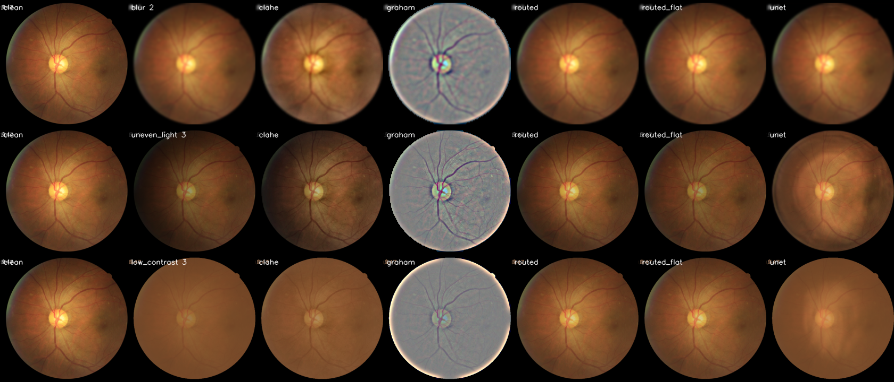
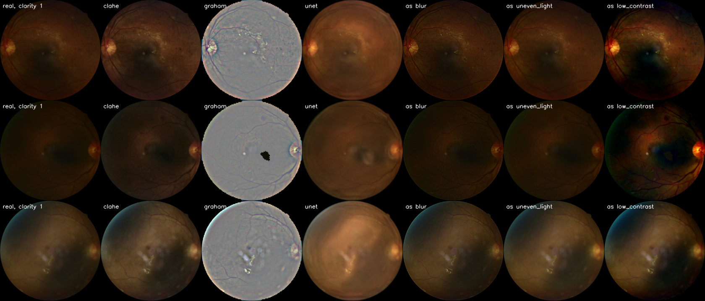

# Enhancement stays on the screen and out of the model

No fix I tried helped the joint model on real photos, so the enhanced photo is only for a person to look at. The model always reads the original.

The routed fix does what I wanted on damage I added myself. It uses the reason output to pick one fix: unsharp mask for blur, tilt correction for uneven light, contrast stretch for low contrast, and nothing if no fault is named. All numbers are on validation, and real-photo numbers are means over the three Phase 3 models.

| Target | Needed | Got | |
|---|---|---|---|
| Routed beats always-CLAHE on added faults | CI-backed margin on both | SSIM +0.032 (0.031 to 0.033), PSNR +7.2 dB (7.0 to 7.4) | pass |
| Good photos barely change | SSIM at least 0.98 | 0.9998, with 0.34% of photos under 0.98 | pass |
| AUROC drop on real photos | at most 0.005 | 0.0021 on the mean | pass, see below |
| Time at 512 px, one thread | at most 50 ms | 8.9 to 22.8 ms depending on the fix | pass |
| At least 15% of Reject photos move up and AUROC on them improves (stretch) | both | 11.1%, and AUROC falls from 0.883 to 0.879 | missed |

## Scores on added faults

These are the same fixed damaged photos as Phase 1 and Phase 3, without the undamaged ones.

| Fix | SSIM | PSNR | Blur SSIM | Uneven light SSIM | Low contrast SSIM | Good photos SSIM |
|---|---|---|---|---|---|---|
| Nothing | 0.899 | 24.5 | 0.869 | 0.895 | 0.931 | 1.000 |
| Always CLAHE | 0.915 | 23.1 | 0.856 | 0.927 | 0.956 | 0.945 |
| Always flat-field | 0.912 | 21.6 | 0.843 | 0.967 | 0.921 | 0.963 |
| Graham subtraction | 0.761 | 12.2 | 0.751 | 0.729 | 0.804 | 0.606 |
| Tiny U-Net | 0.913 | 25.6 | 0.865 | 0.939 | 0.930 | 0.995 |
| Routed, model picks the fault | 0.947 | 30.3 | 0.879 | 0.971 | 0.983 | 0.9998 |
| Routed, told the true fault | 0.947 | 30.5 | 0.879 | 0.973 | 0.983 | 1.000 |

The model's reason is good enough here that knowing the true fault adds almost nothing. These faults are also ones I wrote the fixes for, and the tilt fix in particular assumes the same straight-line shading that `add_uneven_light` produces, so this comparison leans my way. Swapping flat-field in, which assumes no shape, still gets 0.944 and 29.7 dB. I kept tilt because flat-field also removes the normal fall-off in brightness at the rim, but I can't show that tilt is better on real uneven light.

Blur barely moves, from 0.869 to 0.879. An unsharp mask can't bring detail back, so a blurred photo needs a retake.

## What it does to the model

The model was not retrained on any of this. So these numbers say what happens if you feed a fixed photo to this model, not whether a model trained on Graham photos could do well. Plenty of people do that, and I didn't try it.

| Fix | Quality macro-F1 | AUROC, Good + Usable | AUROC on Rejects | DeepDRiD AUROC |
|---|---|---|---|---|
| Nothing | 0.909 | 0.914 | 0.883 | 0.967 |
| Always CLAHE | 0.857 | 0.869 | 0.889 | 0.944 |
| Always flat-field | 0.862 | 0.903 | 0.881 | 0.960 |
| Graham subtraction | 0.598 | 0.645 | 0.739 | 0.814 |
| Tiny U-Net | 0.887 | 0.911 | 0.855 | 0.963 |
| Routed | 0.879 | 0.911 | 0.879 | 0.960 |

Routed passes the AUROC target, and it touches only 11.5 to 13.7% of photos. But quality macro-F1 falls by 0.030, and that's the number that convinced me. A bad photo that has been brightened fools the quality grader into thinking it's fine. If the app graded the fixed photo, it would ask for fewer retakes on photos that still needed them. So 11% of Rejects moving up isn't a gain, and I didn't count it as one. On those photos AUROC goes down.

The paired AUROC gap for routed against nothing is -0.003 to -0.001, -0.006 to +0.001, and -0.003 to -0.001 across seeds, so one seed could be past the 0.005 limit. DeepDRiD drops by 0.007, which is more than the limit, though that target was on EyeQ.

## What I got wrong on the way

My first flat-field barely did anything: SSIM 0.899 against 0.896 for no fix on training photos. Two bugs. A shaded corner could drop below the mask threshold and stay dark, and I was evening the photo out to its darkened average brightness when the bright side is closer to the original. Fixing both took it to 0.966, and the tilt fix reached 0.972.

A unit test caught another one. On a test photo `stretch` did nothing, because the black pixels at the rim counted as huge contrast, so it decided no stretch was needed. It now measures well inside the retina, which moved low contrast from 0.973 to 0.984.

The U-Net was the disappointment. At 12 or 16 base channels it took 77 to 83 ms, so I went with 8 at 45 ms. That first one reached only 0.909. My guess was that it couldn't see far enough across the photo to judge uneven light, so I added one low-resolution level. That took uneven light from 0.929 to 0.939 and overall to 0.913. I stopped there because a much bigger network wouldn't fit in 50 ms. It has 77,484 parameters and trained in 7 minutes. A bigger network would probably do better, so all I can say is that this one lost at this speed limit.

## Looking at real photos

Scores on added faults hide the scariest part. These are the three DeepDRiD validation photos with the lowest Clarity. The last three columns force each routed fix, including ones the model wouldn't have picked.

In the second row, both Graham and the U-Net leave a dark blob near the centre of the retina, and that isn't in the original. The contrast stretch pushes a dark photo into false colours and deepens the dark area around the macula. A reader could take any of those for disease. I haven't measured how often it happens, and I can't judge it properly without a doctor. So if the app shows an enhanced photo, it has to sit beside the original and be marked as not for grading.

Those dark photos also show a fault I never simulated. They're just too dark, which isn't quite low contrast or uneven light. That may explain some of the real Rejects where the model names no fault. I can't confirm it without labels.

Figures use DeepDRiD photos (CC-BY-SA-4.0). I stuck to those because DeepDRiD's licence clearly allows it, and I'm not sure the EyePACS rules do.

## Open

Nothing here shows that a person reads the enhanced photo better. That needs graders, and I don't have any.

Real blur and real uneven light aren't my simulations, so the routed numbers are upper limits.

Stretch can be too strong on dark photos. I didn't change the 4x cap because nothing on my validation photos measures that harm, but I'd like a safer rule before Phase 8 shows this to anyone.
