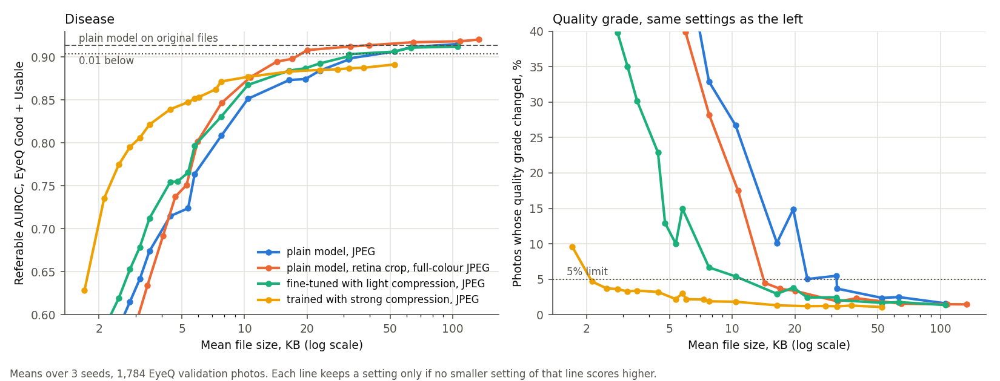

# How small can the photo get?

Crop to the retina on the phone, then save it as a 384 px JPEG at quality 95 with full-resolution colour. That's 40 KB on average, against 1,041 KB for the original EyePACS files. The model I already had reads it as well as the original, on all three seeds. On a 50 kbit/s link it takes about 6.5 seconds.

I got there on the second try. The first round ended at 73 KB, and I expected compression training to beat it. It didn't, even after I changed how I trained. The gain came from changing what gets sent.

## How I measured it

I started from the original files of the 1,784 EyeQ validation photos and tried each encoder at quality 95 down to 10 and long side 1024 down to 256, with and without a crop to the retina that turns the surround black. Encoders were JPEG and WebP from OpenCV 4.11.0, and later JPEG with 4:4:4 colour. Each compressed photo then went through the same steps as in training. I checked that the uncompressed run gives exactly the Phase 3 scores.

Each model gets one threshold, set on its original-file scores at 85% sensitivity on Good + Usable photos (247 referable out of 1,447). That threshold never moves. 85% is a placeholder until Phase 7 picks the final one, so I also ran 80% and 90%.

A setting passes when the mean over three seeds loses under 2 points of sensitivity and under 2 points of specificity, and changes the quality grade of at most 5% of photos.

## The plain model

| Setting | KB | AUROC | Sens. drop | Spec. drop | Grades changed | Seeds passing |
|---|---|---|---|---|---|---|
| Original files | 1,041 | 0.914 | | | | |
| JPEG 1024 px q95 | 105.5 | 0.915 | -1.2 | 2.2 | 1.6% | 1 of 3 |
| JPEG 768 px q85 | 31.9 | 0.898 | 0.4 | 3.8 | 3.7% | 0 |
| Crop, JPEG 512 px q95 | 47.4 | 0.913 | -1.1 | 2.0 | 2.7% | 1 of 3 |
| Crop, WebP 768 px q95 | 73.3 | 0.914 | -0.8 | 0.1 | 2.1% | 3 of 3 |
| Crop, full-colour JPEG 384 px q95 | 39.6 | 0.914 | -0.1 | 0.5 | 2.3% | 3 of 3 |
| Crop, full-colour JPEG 384 px q85 | 20.1 | 0.908 | -1.4 | 2.9 | 3.4% | 1 of 3 |

Drops are in points, and negative means it went up. Plain JPEG never passes at 85% sensitivity, and the closest is 105 KB with specificity down 2.2 points. As files get smaller, specificity collapses long before sensitivity does: JPEG 1024 px at quality 30 loses 42 points of specificity and gains sensitivity. The model reads blocky artefacts as disease.

Three things add up in the 40 KB setting.

The crop. EyePACS photos are wide and the retina fills only part of the frame, so without it a lot of pixels go on black. I didn't separate what the crop does from what the black surround does.

Colour. Normal JPEG and lossy WebP store colour at half resolution. Small red lesions are mostly a colour difference, so I tried JPEG that keeps colour at full resolution. At about the same size it's clearly better: the normal crop at 512 px q95 is 47 KB and passes on 1 seed, while the full-colour one at 384 px is 40 KB and passes on 3.

The size. 384 px is exactly what the network takes in, so the photo arrives at the right size and nothing gets scaled after decoding.

At 80% and 90% sensitivity it passes on 8 of 9 seed and threshold pairs. The one miss is seed 2 at 90%, where specificity drops 2.5 points. The next ones up, 768 px q85 and 512 px q95 at 65 KB, also pass on all three seeds, so it isn't a lone lucky point.

The 2-point rule is still too fine for 247 positives. Seed by seed, the paired interval on the sensitivity drop at 40 KB is -2.4 to +3.1, -3.3 to +2.7 and -2.9 to +1.9 points. I can't tell a 2-point loss from no loss on this set.

I also picked this setting out of 270 on validation, which flatters it a little. The test set in Phase 9 will check it.

## Compression training, twice

First I trained the Phase 3 model from scratch with random JPEG or WebP on its training photos. Those are the 512 px crops, because I deleted the training originals in Phase 0. Then I tried fine-tuning the finished plain model for 6 epochs at a tenth of the learning rate, some runs with a frozen copy of it as a teacher on the compressed photos. Clean validation, before any compression:

| Training | Clean share | Sides | Quality | Seeds | AUROC | Macro-F1 |
|---|---|---|---|---|---|---|
| None | all | | | 3 | 0.914 | 0.909 |
| From scratch, light | 50% | 512 | 75 to 95 | 3 | 0.901 | 0.904 |
| From scratch, mild | 50% | 384, 512 | 50 to 95 | 3 | 0.898 | 0.903 |
| From scratch, mild + consistency 0.1 | 50% | 384, 512 | 50 to 95 | 1 | 0.886 | 0.908 |
| From scratch, strong | 20% | 256 to 512 | 10 to 95 | 3 | 0.881 | 0.900 |
| From scratch, strong + consistency 1.0 | 20% | 256 to 512 | 10 to 95 | 3 | 0.772 | 0.882 |
| Fine-tuned, light | 50% | 512 | 75 to 95 | 3 | 0.910 | 0.905 |
| Fine-tuned, mild + teacher | 50% | 384, 512 | 50 to 95 | 3 | 0.908 | 0.902 |
| Fine-tuned, strong + teacher | 20% | 256 to 512 | 10 to 95 | 1 | 0.886 | 0.897 |

From scratch, even the lightest level costs 0.013 AUROC, and all three light seeds sit below all three plain seeds. The consistency penalty made things worse at both weights. At 1.0 it probably learned that the cheapest way to make clean and compressed answers agree was to say less about disease. I don't know why such mild compression hurts. One guess is that the plain model leans on fine texture, and some of that is lesions while some may be camera or file detail. I didn't test that.

Fine-tuning fixed the clean cost. The frozen teacher can't drift, so the collapse doesn't happen, and the light and mild versions land within 0.006 of plain. But they don't send smaller files. The fine-tuned light model passes on all three seeds only at 79 KB. Strong compression still costs too much, even with the teacher.

Quality grading did get sturdier. Strong training keeps grade changes under 3% down to about 5 KB, where the plain model changes up to 40%.

## My rule could be gamed

On the rule alone, the from-scratch models look great. Strong training passes with JPEG at 16 KB, and the strong + consistency model passes at 2.8 KB with an AUROC of 0.76. The rule only measures the drop from each model's own original score, so a model that starts worse has less to lose.

So I also asked each setting to keep AUROC within 0.01 of the plain model on originals. With that floor, no from-scratch strong or mild model passes anywhere. Specificity with the threshold re-fit to 85% sensitivity tells the same story: the plain model gets 0.804 on originals and 0.807 at 40 KB, and strong training at its 16 KB passing setting gets 0.715.

The figure shows where each one wins. Below about 10 KB the strong model is clearly best, but by then AUROC is under 0.88 for everything. Above about 11 KB the plain model with the cropped full-colour JPEG matches or beats every trained one.

## Against the targets

| Target | Needed | Got | |
|---|---|---|---|
| Smallest file, sensitivity drop under 2 points | report with CI | 39.6 KB, intervals above | done, but 2 points can't be resolved |
| Specificity drop at that size | under 2 points | 0.5 | pass |
| Grade changes at that size | at most 5% | 2.3%, and 0.7% newly called Reject | pass |
| Compression training at least 30% smaller | same rule | no trained model beats the plain one once AUROC is held | missed |
| Retina-aware encoder at least 15% smaller than plain JPEG | same sensitivity | plain JPEG never passes, and its closest is 105 KB. With only the AUROC floor, 39.6 against 52.4 KB, 24% smaller | pass |
| At most 60 KB (stretch) | | 39.6 KB, 3 of 3 seeds | pass |

The 13 from-scratch runs took 7.2 hours and the 7 fine-tunes 70 minutes. The five sweeps took 112, 173, 176, 66 and 113 minutes.

## Open

I'm keeping the plain Phase 3 model.

The phone has to do the crop and save the JPEG with 4:4:4 colour. I haven't checked what a phone browser's JPEG encoder does with colour. If it can't be told to keep full colour, Phase 8 needs its own encoder, or it falls back to the 73 KB WebP.

If the phone always sends the same setting, Phase 7 could set the threshold on that setting directly, since it isn't being re-tuned per level. At 40 KB it would barely change anything.

This is the model reading compressed photos. Whether a human grader can still see the lesions at 40 KB, I can't say. And these are desktop fundus cameras saved at high quality. A phone attachment has its own sensor noise and its own compression before my code sees anything.
